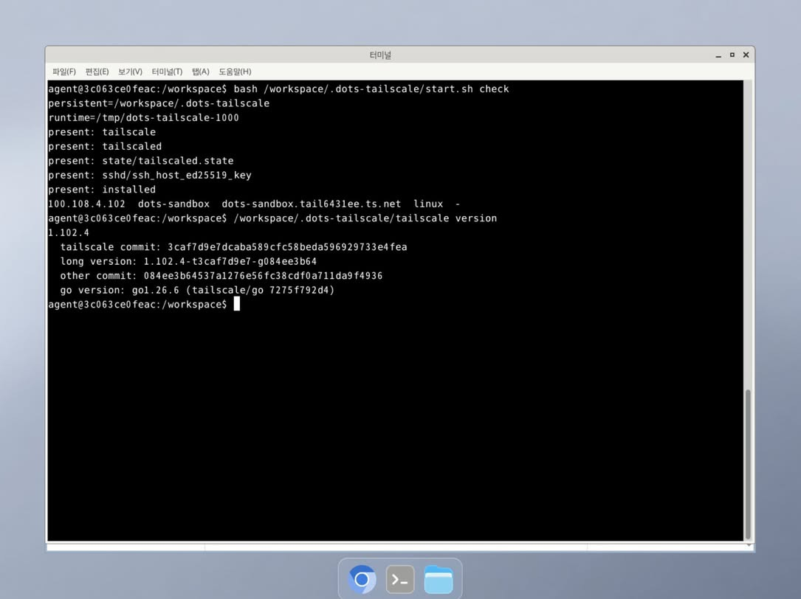

<h1 align="center">dots-tailscale</h1>

<p align="center"><a href="https://github.com/abruption/dots-tailscale/stargazers"></a></p>

<p align="center"><a href="README.md">English</a> · <a href="README.ko.md">한국어</a> · 简体中文 · <a href="README.ja.md">日本語</a></p>

**v0.10.0：** 全新安装时，可以用 `DOTS_TS_SSH_PORT` 选择 2222 等 SSH 端口。默认仍为 22，现有安装的端口不会改变。请查看[发布说明（英文）](docs/releases/v0.10.0.md)和[端口选择指南](docs/usage.zh-CN.md#new-install-ssh-port)。

通过 Tailscale 和 SSH，你可以从自己的设备连接 Dots 云电脑。dots-tailscale 不需要 root 权限或 systemd，会将安装文件、Tailscale 节点状态和 SSH 身份信息保存在 `/workspace` 中。环境变化后，只要这个目录还在，就可以继续使用原来的安装和身份。

**本指南适用于 [v0.10.0](https://github.com/abruption/dots-tailscale/releases/tag/v0.10.0)，安装前请在发布页面确认已发布的文件。** 此版本包含 v0.7.1 的安全修复，在生成证书前验证 CONNECT 目标主机（[GHSA-84m8-25vr-f74m](https://github.com/abruption/dots-tailscale/security/advisories/GHSA-84m8-25vr-f74m)）；v0.7.0 及更早版本受影响。新安装使用 Tailscale 1.104.4。本项目独立开发，并非 OpenAI 或 Tailscale 的官方工具。

**v0.10.0 已正式发布。安装或更新前，请独立验证发布文件及其来源证明。仅有标签或校验和一致，不能认证发布者身份。**

**从 v0.6.0 等旧基线更新时：** 默认声明为 Tailscale 1.102.4 的软件包，需要先更新运行时，再执行[明确的安全基线迁移（英文）](docs/security-baseline.md)。普通 `update apply` 仍保留跨基线变更检查。

**首次从 v0.9.1 或更早版本升级时：** 即使使用端口 22，也请在运行旧 updater 前完成[已验证来源的候选包 SSH 预检](docs/usage.zh-CN.md#new-install-ssh-port)。不受支持的自定义 SSH 配置可能会被拒绝。升级期间不要更改配置，并暂停旧的自动源码更新。

## v0.10.0 功能

下方安装示例固定为 **v0.10.0**。自动更新和恢复执行器需要明确启用，普通安装不会注册自动启动或恢复任务。

| 功能 | 需要了解的范围 |
|---|---|
| 新安装时选择 SSH 端口 | 全新安装时可通过 `DOTS_TS_SSH_PORT` 选择 2222 等端口，默认仍为 22。不支持迁移现有安装的端口。请查看[端口选择说明](docs/usage.zh-CN.md#new-install-ssh-port)。 |
| 运行版本与基线比较 | `version` 和 `doctor` 会将安装中声明的基线与分别观测到的版本比较。连接正常或符合基线，都不是安全性结论。 |
| 更严格的软件包来源验证 | 更新到 v0.8.0 及以上版本，需要发布来源证明、预先准备的可信 `gh`，以及单独获取的信任根。未签名的旧版本只能走明确的人工审核例外，自动更新不能使用该例外。 |
| 离线检查更新包 | `update check --bundle` 可以在不修改安装的情况下比较已审核的本地文件包。它不会重新确认最新发布状态或发布者身份。 |
| shim 并发连接上限 | 默认最多接受64个活动连接；由运维人员管理的启动方式可选择1–256个。正常的 control/DERP 连接不会因此被限制存活时间。 |
| 可选的更新与恢复执行器 | 明确启用前均不会运行。仍需具备执行环境；VM 被替换、执行进程消失后，执行器无法自行重启。软件包自动更新不会更新 Tailscale 二进制文件。 |

只有先停止旧 watchdog，并让内部、外部执行方**都**切换到统一恢复入口，才会共用本地恢复记录和本地尝试预算。生产任务如果仍直接调用 `start.sh`，就仍在使用旧路径。MCP 路径继续作为高级用户预览：另一个真实账号的设置与恢复复现测试**尚未完成**，因此不能视为已提供通用自动恢复支持。

启用前，请阅读[v0.10.0 使用说明](docs/usage.zh-CN.md#development-v0100)、[自动更新（英文）](docs/automatic-updates.md)、[来源验证（英文）](docs/release-provenance.md)、[恢复协调（英文）](docs/recovery-lifecycle.md)和[预览准备情况（英文）](docs/recovery-support-readiness.md)。

v0.9.0 修正了对稳定版后端长版本号的诊断。研究用 MCP 配置还新增了[事件已接收但尚未创建 claim 时的有界后续提醒（英文）](research/mcp-events/recovery-followups.md)，以及[恢复预算汇总与运维告警（英文）](research/mcp-events/recovery-budget-observability.md)。后续提醒和告警默认都关闭，需要单独部署和配置；普通安装不会启用。提醒本身不授予执行权限，也不保证 VM 替换后的恢复。

## 可以做什么

| 操作 | 用途 |
|---|---|
| 安装与重新连接 | 配合本地 OpenSSH 运行 Tailscale；重启保留下来的安装时，继续使用已有状态和密钥。 |
| 检查连接 | 通过 `dots-ts version` 和 `doctor` 查看安装文件完整性、进程、套接字和后端状态。 |
| 访问私有服务 | 使用 tailnet 连接，也可为单独配置的应用启用本地 SOCKS5/HTTP 代理。 |
| 更新软件包 | 用 `dots-ts update` 检查版本并手动更新脚本，也可以选择开启使用缓存的本地通知。 |
| 更新 Tailscale | 用 `dots-ts runtime` 检查版本，并成对更新 CLI 和守护进程；更新进度和恢复记录会保存在文件中。 |

默认不会启用自动启动或自动更新。下文介绍的外部恢复实验需要单独配置。

## 快速开始

**首次安装**请在 Dots 云终端中操作。需要 Linux x86_64、Python 3、Git、OpenSSH，以及绑定所选本地 SSH 端口（默认为 22）的权限；完整依赖和 SSH 设置请参阅[使用指南](docs/usage.zh-CN.md)。已经安装的用户请按下一节更新，不要重新安装。

请在安装前选定端口。如果要使用 2222，请将下方的 `bash tailscale-setup.sh install` 行替换为 `DOTS_TS_SSH_PORT=2222 bash tailscale-setup.sh install`。之后常规的 start/login 命令无需此选项，会使用已保存的端口。此功能不会更改现有安装的端口。

```bash
cd /workspace
HTTPS_PROXY=http://browser-proxy:8889 HTTP_PROXY=http://browser-proxy:8889 \
  git clone --branch v0.10.0 --depth 1 https://github.com/abruption/dots-tailscale.git
cd dots-tailscale
bash tailscale-setup.sh check
bash tailscale-setup.sh install
bash /workspace/.dots-tailscale/start.sh login
```

打开首次登录时输出的授权链接。将客户端公钥加入安装目录中的 SSH `authorized_keys` 文件，并在连接前通过云终端独立核对主机密钥指纹。具体步骤见[使用指南](docs/usage.zh-CN.md)。

在已测试的 Dots SSH 环境中，直接通过 HTTPS 访问 GitHub 失败，因此 clone 命令显式使用了平台代理。如果仍无法下载，请参阅[下载诊断与其他传输方式](docs/usage.zh-CN.md#download-proxy)。四个源文件必须与它们对应的原始 `source-manifest.json` 放在一起。

环境变化后，如果安装目录仍然保留，运行下面的命令即可重新启动：

```bash
bash /workspace/.dots-tailscale/start.sh
```

## 更新已有安装

需要分别管理两个版本：

| 命令 | 更新内容 | 不会更新 |
|---|---|---|
| `dots-ts update` | dots-tailscale 脚本和软件包元数据 | Tailscale 二进制文件 |
| `dots-ts runtime` | 已安装的 `tailscale` 和 `tailscaled` 文件对 | dots-tailscale 软件包 |

先检查已安装的软件包和可用的软件包版本：

```bash
/workspace/.dots-tailscale/dots-ts version
/workspace/.dots-tailscale/dots-ts update check --tag v0.10.0 --proxy http://browser-proxy:8889 --json
```

此版本保留了 v0.9.1 的代理环境修复，守护进程的大写和小写代理变量均使用本地 shim。已在冲突环境中运行的守护进程仍需单独安全重启；软件包更新不会改写运行中的进程环境。请查看[诊断与恢复说明（英文）](docs/proxy-environment.md)。

从 v0.8.0 之前的更新器首次迁移时，请按[独立验证的首次迁移流程（英文）](docs/release-provenance.md)操作。在执行候选工具之前，先验证原始清单和四个源文件的来源。仅凭哈希一致无法认证发布者。

v0.7.0 软件包声明相同的 Tailscale 基线，可通过普通[软件包更新](docs/usage.zh-CN.md#update-management)升级到 v0.7.1，应用后会以修复后的 shim 重新启动。Tailscale 基线声明为 1.102.4 的现有软件包（包括 v0.6.0），需要按[安全基线迁移流程（英文）](docs/security-baseline.md)更新到 v0.7.1。工具早于 v0.6.0 时，请先按[软件包更新说明](docs/usage.zh-CN.md#update-management)安装同一基线的 v0.6.0。缺少可信元数据的旧安装需要手动检查。这些旧版步骤用于对齐基线；迁移到 v0.10.0 时，请按上方的独立验证流程操作。

安装 v0.6.0 或更新的工具后，可以检查 Tailscale 官方稳定版：

```bash
/workspace/.dots-tailscale/dots-ts runtime check --json
```

**v0.10.0 新安装使用 Tailscale 1.104.4。** 软件包更新和 `install` 不会悄悄替换已有二进制文件。需要更新时，请先核对查询到的版本和官方公告，再按[手动更新指南（英文）](docs/runtime-updates.md)操作。基线迁移要求两个已安装的二进制文件和运行中的后端都恰好为 1.104.4，然后才更换源码。

应用更新前，请确认可以操作一个不依赖 Tailscale 连接的云端恢复终端。更新 Tailscale 二进制文件时，应先暂停外部恢复任务，待新的 SSH 连接和 ping 检查通过后再恢复。一旦尝试执行候选守护进程，即使启动失败，也不会自动降级；失败后的状态不明确时，需要按指南手动恢复。回退软件包代码与 Tailscale 状态数据是否兼容，是两回事。

## 常用命令

```bash
# 查看软件包完整性及独立的 Tailscale 版本
/workspace/.dots-tailscale/dots-ts version
# 诊断本地安装与连接状态
/workspace/.dots-tailscale/dots-ts doctor
# 使用对应套接字运行已安装的 Tailscale CLI
/workspace/.dots-tailscale/dots-ts cli status
# 查看可选的应用代理设置
/workspace/.dots-tailscale/dots-ts proxy show
```

本地 SOCKS5/HTTP 代理默认关闭，启用时需要显式重启守护进程。它们不会自动配置 Dots 浏览器、ChatGPT 连接器或 MCP 客户端。详见[代理指南](docs/usage.zh-CN.md#development-helpers)和[私有 HTTPS API 示例](docs/private-http-api.zh-CN.md)。

## 已验证的范围

- [v0.10.0 标签所指提交的 CI](https://github.com/abruption/dots-tailscale/actions/runs/43715115507)在 Linux Python 3.11 和 3.13 上分别通过了 601 项测试。[2026-11-15 验证记录（英文）](docs/validation/ssh-port-new-install-20261115.md)涵盖隔离环境中的 22、2222 端口安装、启动、doctor、更新、失败处理及身份保留检查。这些是测试环境结果，不是真实 tailnet 试验，也不能证明所选端口可从外部访问。
- 一次 [Dots 实环境测试](docs/validation/runtime-update-trial-20261026.md)使用经过审核的开发版软件包，将 Tailscale 从 1.102.4 更新至 1.104.2。节点与 SSH 身份保持不变，随后通过了新的外部 SSH 连接和中继 ping 检查。
- [v0.6.0 发布页](https://github.com/abruption/dots-tailscale/releases/tag/v0.6.0)记录了最终提交的核心与研究测试，以及隔离环境中的官方二进制文件检查。这些结果不能证明所有未来版本都兼容，也不能证明实环境故障恢复或状态数据降级一定安全。
- [v0.7.0 发布页](https://github.com/abruption/dots-tailscale/releases/tag/v0.7.0)增加了隔离的新安装与源码迁移测试。随后的 [2026-10-28 实环境源码迁移测试](docs/validation/v0.7.0-migration-trial-20261028.md)将一个现有安装的软件包从 0.6.0 迁移至 0.7.0，保留了已安装的 Tailscale 1.104.4 运行环境以及节点与 SSH 身份；迁移后，采用严格主机密钥验证的新 SSH 连接和中继 ping 均成功。这不代表已验证全新安装、其他账户、实环境故障注入、中断事务修复、VM 更换、运行时状态降级或所有未来版本。[发布前的基线与 TLS 检查](docs/validation/security-baseline-20261028.md)仍是独立的历史记录。
- `/workspace` 能够保留是使用条件，并非平台保证。运行时的套接字、PID 和日志会在 `/tmp` 中重新创建。进入新环境后，仍需要某种方式来执行启动命令。
- 本地显示 `Running` 不代表外部一定能够连接。请重新建立 SSH 连接，并检查实际使用的应用访问路径。更新到 1.104.2 并不意味着 Tailworm 已被修复。



这张由维护者提供的截图是过去的安装与状态检查记录，不代表当前软件包版本，也不能证明 VM 替换后的恢复情况。之后的更新测试见上方带日期的记录。

## 外部恢复实验

在 v0.10.0 中，本地 watchdog／恢复协调和软件包自动更新默认关闭，需要明确启用。[外部恢复实验（英文）](docs/experimental-recovery.md)需要单独配置。普通安装不会部署外部监控或 MCP Events 服务器，也不会连接 ChatGPT 应用或注册并授权 Dots 恢复任务。

外部恢复路径需要运维者管理的服务器和 SSO 配置。事件处理可能延迟，其他账号的设置复现和任意 VM 替换后的恢复仍未验证。支持范围与运行环境生命周期的研究继续由现有 [#45](https://github.com/abruption/dots-tailscale/issues/45) 和 [#20](https://github.com/abruption/dots-tailscale/issues/20) 跟踪。

[v0.10.0 验证记录（英文）](docs/validation/ssh-port-new-install-20261115.md)仅涵盖隔离测试环境中的检查，不能证明实际使用中的 VM 的恢复成功或真实 tailnet 的可达性。剩余验证范围请参阅[预览准备条件（英文）](docs/recovery-support-readiness.md)。

从版本历史来看，[v0.8.0](https://github.com/abruption/dots-tailscale/releases/tag/v0.8.0) 引入了 watchdog 协调和可选自动更新，而 [v0.7.1](https://github.com/abruption/dots-tailscale/releases/tag/v0.7.1) 早于这些功能。这些是历史发布说明，不是当前功能的启用步骤。

## 文档与项目文件

- [使用与故障排查](docs/usage.zh-CN.md) · [手动更新 Tailscale（英文）](docs/runtime-updates.md)
- [私有 HTTPS API 示例](docs/private-http-api.zh-CN.md) · [恢复实验（英文）](docs/experimental-recovery.md)
- [发布说明（英文）](docs/releases/v0.10.0.md) · [更新记录](CHANGELOG.md) · [MIT 许可证](LICENSE)

| 路径 | 用途 |
|---|---|
| `tailscale-setup.sh`, `shim.py` | 安装与启动、本地 OpenSSH，以及兼容代理的 Tailscale 通信 |
| `dots-ts`, `dots_proxy.py` | 诊断、软件包与 Tailscale 更新，以及可选的应用代理设置 |
| `source-manifest.json` | 软件包版本和四个源文件的校验和 |
| `home-persistence-probe.py` | 记录 HOME 与 `/workspace` 的保留情况标记 |
| `tests/`, `research/` | 回归测试和单独部署的研究工具 |
