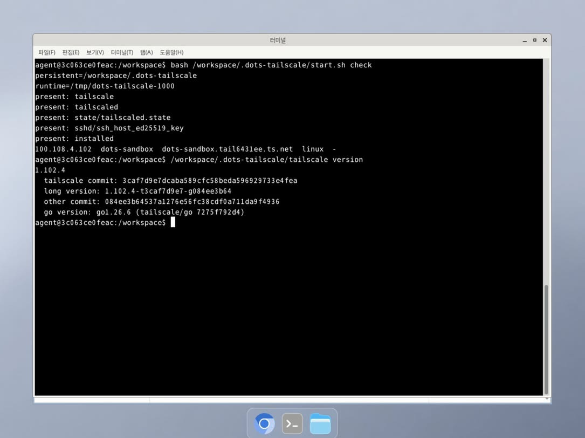

# 사용 가이드

[English](usage.md) · 한국어 · [简体中文](usage.zh-CN.md) · [日本語](usage.ja.md) · [프로젝트 소개](../README.ko.md)

`/workspace`가 환경 교체 후에도 유지되는 Dots 환경에서 실행합니다. 저장된 자격증명이 유효하면 설치 파일, 인증 상태, SSH 호스트 키를 재사용해 새로 로그인하지 않고 복구할 수 있습니다. 설치 시 자동 시작 훅은 등록하지 않으므로 새 환경마다 start 명령을 실행해야 합니다.

## 공개 릴리스

공개 저장소 주소는 `https://github.com/abruption/dots-tailscale`입니다. 최초 공개 시 실제 clone과 raw 다운로드를 확인했습니다. [v0.3.1 릴리스](https://github.com/abruption/dots-tailscale/releases/tag/v0.3.1)는 ZIP·tar.gz와 `tailscale-setup.sh`·`shim.py`·`dots-ts`·`dots_proxy.py` 개별 파일을 제공합니다. `main`은 이후 변경될 수 있으므로 같은 소스로 다시 설치하려면 검토한 tag나 commit을 지정하세요.

<a id="download-proxy"></a>

## 다운로드와 프록시 연결 확인

2026-10-15 Dots에 SSH로 접속해 확인했을 때, 프록시 없이 GitHub 저장소·raw 파일·릴리스 파일에 직접 HTTPS 요청을 보내면 curl이 종료코드 `7`로 실패했고 Git clone도 실패했습니다. `http://browser-proxy:8889`를 명시하면 세 URL은 모두 HTTP `200`을 반환했고, `v0.2.0` clone과 두 raw 파일 다운로드도 성공했습니다. raw 파일은 해당 tag의 소스와 SHA-256이 일치했습니다. 이는 당시 확인한 Dots 터미널 환경의 결과이며 모든 Dots 환경이나 외부 HTTPS 주소에 대한 차단을 뜻하지 않습니다. 브라우저의 `ERR_*` 오류는 터미널과 실행 환경이 다르므로 별도로 확인해야 합니다.

다운로드나 clone이 실패하면 같은 Dots 터미널에서 다음 명령으로 프록시 경유 연결을 확인하세요. 저장소 페이지, raw 설치 파일, 릴리스 설치 파일 순서이며, 각 요청은 연결 5초·전체 20초로 제한합니다. 검사한 원본 URL과 HTTP 상태 코드만 표시하며, 본문과 리디렉션 목적지의 서명된 URL은 출력하지 않습니다.

```bash
for url in \
  'https://github.com/abruption/dots-tailscale' \
  'https://raw.githubusercontent.com/abruption/dots-tailscale/v0.2.0/tailscale-setup.sh' \
  'https://github.com/abruption/dots-tailscale/releases/download/v0.2.0/tailscale-setup.sh'
do
  printf '%s\n' "$url"
  curl --fail --silent --show-error --location \
    --proxy http://browser-proxy:8889 --connect-timeout 5 --max-time 20 \
    --output /dev/null --write-out 'HTTP %{http_code}\n' "$url"
done
```

직접 연결과 비교하려면 같은 명령에서 `--proxy http://browser-proxy:8889`를 `--noproxy '*'`로 바꾸세요. curl 종료코드 `7`은 연결 실패, `28`은 시간 초과를 뜻합니다. 코드만으로 방화벽·DNS·프록시 등 구체적인 원인을 단정할 수는 없습니다. curl 오류 메시지도 함께 확인하세요. 환경에서 제공하는 프록시 주소가 다르면 명령의 주소를 바꾸고, HTTPS 인증서 검증은 유지하세요.

프록시 설정은 다음 범위에 적용됩니다.

| 설정 | 적용 범위 |
|---|---|
| clone·fetch 앞의 `HTTPS_PROXY`·`HTTP_PROXY` | 해당 Git 명령에만 적용하며 전역 Git 설정은 바꾸지 않음 |
| `curl --proxy` | 해당 다운로드·진단 요청에 적용 |
| `UPSTREAM_PROXY` | 설치 스크립트의 Tailscale 다운로드와 실행 시 shim의 업스트림 연결에 사용. 기본값은 `http://browser-proxy:8889` |

실행 시 shim은 로컬 `127.0.0.1:18089`에서 Tailscale용 연결을 중계합니다. 이 주소는 다른 앱이나 시스템 전체에 설정할 프록시가 아닙니다. Git clone이나 raw 파일 다운로드에는 위 예시처럼 환경에서 제공하는 프록시를 직접 지정하세요.

## 최초 설치

Linux x86_64, Python 3, OpenSSH, `timeout`, `flock`, `openssl`, `ssh-keygen`, `curl`, `tar`, `sha256sum`, 일반 사용자 포트 22 바인딩을 전제로 합니다. 다운로드에 사용할 기본 프록시는 `http://browser-proxy:8889`, Tailscale 다운로드 버전은 `1.102.4`로 고정하고 공식 SHA-256과 대조합니다.

Git이 설치된 VM 터미널에서 HTTPS로 저장소를 clone한 뒤 설치 스크립트를 실행합니다. Git 네트워크 요청에만 프록시 환경변수를 적용합니다. 인증서 검증은 유지합니다.

v0.3.1은 `tailscale-setup.sh`, `shim.py`, `dots-ts`, `dots_proxy.py` 네 파일을 함께 준비해야 합니다. 이전 v0.2.0은 기존 두 파일로 설치하며 새 도구가 포함되지 않습니다.

```bash
cd /workspace
HTTPS_PROXY=http://browser-proxy:8889 HTTP_PROXY=http://browser-proxy:8889 \
  git clone --branch v0.3.1 --depth 1 'https://github.com/abruption/dots-tailscale' dots-tailscale
cd dots-tailscale
bash tailscale-setup.sh check
bash tailscale-setup.sh install
bash /workspace/.dots-tailscale/start.sh login
```

`login`에서 출력하는 URL로 인증합니다. `install`은 파일만 배치하며 프로세스를 시작하지 않습니다. 기존 바이너리·설정·키는 덮어쓰지 않고 파일 차이·부분 손상은 중단합니다. `start.sh`는 설치 과정에서 생성되는 래퍼입니다. 설치된 경로에서 사용하세요.

`check`는 설치 파일의 존재 여부를 출력하고, 실행 중인 소켓이 있으면 Tailscale 상태도 보여줍니다. `missing:`이 있어도 종료코드가 `0`일 수 있으므로 성공 코드만으로 설치 완료를 판단하지 마세요.

SSH는 `127.0.0.1:22`에서 수신하고 공개키 인증을 사용합니다. Tailscale SSH는 꺼져 있으며 셸 연결은 로컬 OpenSSH 서버가 처리합니다. 기존 `$HOME/.ssh/authorized_keys`가 있으면 설치 시 복사합니다. 없으면 빈 `/workspace/.dots-tailscale/sshd/authorized_keys`를 만들므로 사용할 장비의 **공개키**를 한 줄로 추가하고 권한을 `600`으로 지정합니다. SSH 호스트 키 지문은 VM의 GUI 터미널 등 별도 경로로 확인하고 클라이언트 지문과 대조하세요. 호스트 키 검증을 우회하지 않습니다.

Dots의 GUI 터미널에서 다음 명령으로 지문을 확인합니다.

```bash
ssh-keygen -lf /workspace/.dots-tailscale/sshd/ssh_host_ed25519_key.pub
```

Dots 터미널에서 설치된 래퍼로 노드 주소를 확인합니다.

```bash
bash /workspace/.dots-tailscale/start.sh check
```

설치된 CLI와 사용자별 `/tmp/dots-tailscale-$(id -u)/tailscaled.sock`을 사용하므로 전역 `tailscale` 명령이나 기본 socket이 필요하지 않습니다. 주소가 표시되려면 데몬이 이미 실행 중이어야 합니다. 설치 경로를 변경했다면 해당 설치의 `start.sh`를 사용하세요.

접속할 장비에서 `<TAILNET_IP>`를 실제 Dots 주소로 바꾸고 실행합니다. 최초 접속 시 표시되는 지문을 위 결과와 대조한 뒤 일치할 때만 승인하세요. 다르면 `no`로 거부하고 중단하며 키를 등록하거나 기존 항목을 삭제하지 마세요. `ssh-keyscan` 결과만으로 신뢰하지 마세요.

```bash
ssh -o StrictHostKeyChecking=ask -i /path/to/client_private_key 'agent@<TAILNET_IP>' 'id; pwd'
```

승인한 뒤에는 `ssh -o StrictHostKeyChecking=yes -i /path/to/client_private_key 'agent@<TAILNET_IP>' 'id; pwd'`로 접속할 수 있습니다. 사용자명과 SSH 키 경로는 자신의 설정에 맞게 지정하세요. 이후 지문이 달라지면 Dots GUI 터미널에서 다시 확인하세요.

<a id="package-version"></a>

## 패키지 버전과 파일 확인 (개발 중)

v0.4.0을 위해 개발 중인 기능입니다. 위의 v0.3.1 설치 예시에는 포함되지 않습니다. 새 릴리스를 발행해도 기존 설치가 자동으로 바뀌지는 않습니다.

```bash
/workspace/.dots-tailscale/dots-ts version
/workspace/.dots-tailscale/dots-ts version --json
```

GitHub나 tailnet에 접속하지 않고 로컬 패키지 파일을 확인합니다. 명세 파일에 적힌 패키지 버전, 소스 파일 일치 여부, 설치된 Tailscale 실행 파일의 버전을 각각 보여줍니다. 소스 리비전을 알 수 없으면 그대로 알 수 없다고 표시합니다. 파일이 명세와 일치한다고 해서 배포자의 신원이나 실행 중인 서비스의 정상 동작까지 증명되는 것은 아닙니다.

같은 검토된 리비전의 소스 파일 네 개와 `source-manifest.json`을 함께 준비하세요. 새 설치기는 이 묶음을 검증한 뒤 명세를 설치 경로에 보존합니다. 불일치를 없애려고 수정된 설치 파일로 기대 체크섬을 다시 만들면 안 됩니다. 메타데이터가 없는 기존 v0.2/v0.3 설치는 패키지 버전을 알 수 없다고 표시합니다. 내부 Tailscale 버전만으로 패키지 버전을 판단할 수는 없습니다.

업데이트나 원복을 준비할 때는 소스 파일과 해당 원본 명세를 한 묶음으로 보관하고 함께 교체하세요. 오래된 코드에 새 명세만 덮어쓰지 마세요. 노드 상태, 개인키, SSH 식별 정보와 프록시 설정은 보존합니다. 아래 수동 업데이트 주의사항도 그대로 적용됩니다. 이 명령 자체는 업데이트하거나 재시작하지 않습니다.

JSON은 `package.declared_version`, `package.source_revision`, `package.integrity`, 파일별 결과를 `tailscale.version` 및 `tailscale.status`와 구분합니다. 일치 여부는 `match`, 수정되거나 다른 버전이 섞인 `mismatch`, 파일이 없거나 읽을 수 없는 `incomplete`, 메타데이터가 없거나 잘못됐거나 읽을 수 없는 `unknown`으로 표시합니다. `source_revision`은 현재 `null`이며 커밋을 추측하지 않습니다. mismatch/incomplete는 종료 코드 `1`, 나머지는 `0`입니다. 따라서 종료 코드 `0`만으로 버전을 확인했거나 Tailscale 실행 파일이 정상이라고 판단하면 안 됩니다. `doctor`는 메타데이터를 알 수 없으면 degraded, 파일 불일치·누락은 unhealthy로 표시합니다.

유지보수 시에는 검토한 소스 변경 후 `python3 scripts/source_manifest.py`로 명세를 생성하고 차이를 확인한 뒤 `python3 scripts/source_manifest.py --check`로 검사합니다. CI는 파일을 수정하지 않고 검사만 합니다. 설치 경로가 아닌 검토된 소스 체크아웃에서만 생성하세요. 릴리스에는 소스 파일 네 개와 일치하는 명세도 함께 배포해야 합니다. 기존 v0.3.1 릴리스에는 이 명세가 없습니다.

<a id="update-management"></a>

## 새 릴리스 확인과 로컬 알림 (개발 중)

v0.4.0을 위해 개발 중인 기능으로 새 도구가 설치되어 있어야 합니다. 릴리스 발행만으로 기존 설치가 바뀌지는 않습니다. `abruption/dots-tailscale`의 정식 릴리스 중 소스 파일 네 개와 일치하는 `source-manifest.json`이 있는 묶음만 확인합니다. v0.3.1처럼 명세가 없는 기존 릴리스는 검증된 업데이트 대상으로 간주하지 않고 지원되지 않는다고 표시합니다.

```bash
/workspace/.dots-tailscale/dots-ts update check --json
/workspace/.dots-tailscale/dots-ts update check --tag v0.4.0 --proxy http://browser-proxy:8889 --json
```

두 번째 예시는 특정 정식 버전을 선택합니다. 실제로 해당 릴리스가 발행된 뒤에 사용할 수 있습니다. `--proxy`가 없으면 직접 HTTPS로 연결하며 셸의 프록시 자격정보를 가져오지 않습니다. 필요한 경우 플랫폼 다운로드 프록시를 직접 지정하세요. shim이나 애플리케이션 SOCKS·HTTP 프록시와는 별개입니다. HTTPS 인증서 검증은 유지하며 GitHub 토큰은 필요하지 않습니다.

`update check`는 설치 코드, 노드 상태, 설정이나 프로세스를 바꾸지 않습니다. JSON의 `status`는 `update_available`, `current`, `local_newer`, `not_comparable`, `check_failed` 중 하나이고, `selection`은 최신 릴리스 조회인지 특정 버전 선택인지 구분합니다. 정상 비교는 종료 코드 0, 로컬 설치를 비교할 수 없으면 1, 조회 실패는 2입니다. 종료 코드 0만 보고 새 버전이 있다고 판단하지 말고 status를 읽으세요. 원격 릴리스를 찾았다고 해서 버전을 알 수 없거나 파일이 수정·혼합된 로컬 설치가 검증되는 것은 아닙니다.

알림은 직접 켜야 하며 로컬에서만 표시합니다. 업데이트를 설치하거나 타이머를 등록하거나 외부로 메시지를 보내지 않습니다.

```bash
/workspace/.dots-tailscale/dots-ts update notifications configure --enable --interval-hours 24
/workspace/.dots-tailscale/dots-ts update notifications refresh --proxy http://browser-proxy:8889
/workspace/.dots-tailscale/dots-ts update notifications show
/workspace/.dots-tailscale/dots-ts update notifications notify
/workspace/.dots-tailscale/dots-ts update notifications configure --disable
```

`refresh`는 제한된 시간 안에 네트워크로 조회하고 결과를 저장합니다. 설정한 간격 안에서는 유효한 결과를 재사용하며, `--force`를 지정하면 그 전에 새로 조회합니다. `notify`는 저장된 결과만 읽으며 만료된 결과와 같은 버전의 반복 안내를 걸러냅니다. 대화형 터미널에서 기동에 성공하면 짧은 제한 시간 안에 캐시된 안내를 stderr로 보여줄 수 있습니다. 알림 확인이 실패해도 기동 결과는 바뀌지 않습니다. 원시 `cli` 전달이나 JSON 출력에는 안내 문구가 섞이지 않습니다. 저장 경로가 읽기 전용이거나 갱신에 실패해도 오래된 결과를 새로 확인한 결과로 취급하지 않습니다. `show`에서 기록 시각과 stale·오류 상태를 확인하세요. 주기적으로 갱신하려면 호출 수단을 별도로 설정해야 하며, VM이 없을 때는 VM 안의 명령도 실행되지 않습니다.

### 검증된 수동 업데이트

설치 경로, 런타임 소켓과 Linux 프로세스 정보가 보이는 환경에서 실행하세요. `update apply`에는 Linux, Python 3.9 이상과 pidfd 지원이 필요합니다. 먼저 클라우드 컴퓨터의 독립 터미널을 열고 제어가 되는지 확인하세요. `--confirm-recovery-terminal`은 사용자가 이를 확인했다는 뜻이며, 프로그램이 터미널의 작동 여부를 검사해 주지는 않습니다. 작업 프로세스가 호출 세션에서 분리되므로 SSH에서 시작할 수 있지만, 그 SSH 연결 자체를 복구 경로로 삼아서는 안 됩니다.

조회한 정식 릴리스 중 특정 버전을 선택합니다.

```bash
/workspace/.dots-tailscale/dots-ts update apply --tag v0.4.1 --proxy http://browser-proxy:8889 --confirm-recovery-terminal --json
/workspace/.dots-tailscale/dots-ts update status --id TRANSACTION_ID --json
```

사용 예시이며 v0.4.1이 이미 발행되었다는 뜻은 아닙니다. `TRANSACTION_ID`는 apply가 반환한 ID로 바꾸세요. 릴리스 파일 다운로드가 막혔거나 미발행 후보를 직접 시험할 때는 검토한 로컬 소스 묶음을 사용할 수 있습니다.

```bash
/workspace/.dots-tailscale/dots-ts update apply --bundle /workspace/reviewed-bundle --confirm-recovery-terminal --json
```

소스 파일 네 개와 해당 파일에 일치하는 원본 명세가 필요합니다. 로컬 묶음에는 개발 버전을 사용할 수 있지만, 이를 GitHub에 발행된 릴리스로 표시하지는 않습니다. 교체 전에 해시와 문법을 검사합니다. 체크섬 일치는 선택한 묶음과 파일이 같다는 뜻이며, 작성자의 신뢰성을 별도로 증명하지는 않습니다.

`started`는 분리된 작업 프로세스가 작업을 접수했다는 뜻으로, 업데이트 성공이 아닙니다. 재접속 후 `update status`로 확인하세요. 최종 결과는 `applied`, `failed_rolled_back`, `rollback_failed_manual_required`로 구분합니다. 로컬 준비 상태와 버전 확인만으로 외부 SSH 접속까지 확인되지는 않습니다. 적용이나 원복 성공 후에는 엄격한 호스트 키 검증을 유지한 새 SSH 연결로 실제 접속을 별도로 확인하세요.

setup과 proxy apply가 사용하는 작업 잠금을 유지한 채 소스 파일 네 개와 명세만 백업·교체합니다. 정확히 식별한 shim 프로세스만 재시작하고 tailscaled와 sshd는 계속 실행합니다. 노드 상태, 로그인 정보, 개인키, SSH 설정과 프록시 설정은 복사하거나 초기화하지 않습니다. 내부 Tailscale 실행 파일 버전을 바꾸는 릴리스는 이 updater의 지원 범위 밖이므로 거부합니다. 정체를 알 수 없는 프로세스를 종료하거나 소켓을 지우지 않습니다.

설치 파일과 일치하는 명세가 있어야 합니다. 메타데이터가 없는 구버전은 먼저 별도로 확보하고 검토한 릴리스와 설치 파일 네 개를 비교하세요. 설치된 파일에서 기대 체크섬을 새로 만들면 안 됩니다. 출처를 확인할 수 없거나 파일이 섞여 있으면 수동 검토를 위해 멈추세요. 의도적으로 마이그레이션할 때 사용하는 소스 체크아웃도 자체 명세와 일치해야 기존 설치를 대상으로 updater를 실행할 수 있습니다.

이전 작업이 미완료 상태면 새 업데이트를 막습니다. 작업 프로세스가 강제 종료되거나 VM이 교체되면 독립 터미널에서 상태와 코드 백업을 확인하세요. 다시 시도하려고 기록을 삭제하거나 다음 단계가 안전하다고 가정하지 마세요. 원복 후에도 준비 상태를 확인할 수 없으면 증거를 보존하고 검증된 백업으로 수동 복구해야 합니다. 이 updater는 VM을 자동으로 복구하는 서비스가 아닙니다.

작업 기록은 `.update-transactions/TRANSACTION_ID/`에 남습니다. `journal.json`에는 진행 단계, `stage/`에는 선택한 묶음, `backup/`에는 이전 소스 묶음만 저장하고, `supervisor/`에는 updater 코드 사본을 둡니다. 외부 연결을 확인할 때까지 기록을 보존하세요. `update status`의 종료 코드는 진행 중이거나 적용된 작업은 0, 거부·원복·중단·수동 복구 필요 결과는 1입니다. 진행 중 작업의 종료 코드 0은 완료를 뜻하지 않습니다.

`applied`는 선택한 코드가 명세와 일치하고 로컬 준비 검사를 통과했다는 뜻입니다. shim의 실제 CONNECT·WebSocket 통신까지 시험한 결과는 아닙니다. 재시작한 shim에는 기존 upstream 호스트·포트와 절대 경로의 SSL 인증서 설정을 유지하지만, 다른 셸 환경이나 디버그 설정은 물려주지 않습니다. stdout·stderr는 버리므로 기존 `shim.log`에 새 출력이 쌓일 것으로 기대하지 말고, 작업 기록의 고정 오류 코드와 별도 연결 검사로 확인하세요.

중단된 작업은 증거를 삭제하지 않고 다음과 같이 수동 복구를 마무리할 수 있습니다.

1. 독립 터미널에서 작업 프로세스가 종료됐음을 확실히 확인합니다. PID에 접근할 수 없거나 status가 불확실하다는 이유만으로 종료됐다고 판단하지 마세요.
2. 필요하면 검토된 코드 묶음으로 복원해 기동하고, 명세·로컬 준비 상태·새 외부 SSH 연결을 확인합니다. 구버전 도구에서는 별도로 검토한 소스 실행기로 명세를 확인해야 할 수 있습니다.
3. 작업 프로세스가 없고 설치 경로의 `.operation.lock`을 확보한 상태에서, 검토를 마친 작업 디렉터리 전체를 `.update-transactions/` 바깥의 본인 소유·권한 700인 `.update-recovery-archive/`로 옮깁니다. 기록과 백업을 함께 보존하세요. 이렇게 보관하면 미완료 작업 검색에서 제외됩니다. apply 차단을 풀려고 실행 중이거나 검토하지 않은 작업을 옮기면 안 됩니다.

<a id="development-helpers"></a>

## v0.3.1 도구와 선택적 애플리케이션 프록시

아래 명령은 v0.3.1 파일을 함께 설치한 경우에만 사용할 수 있으며, v0.2.0에는 없습니다. `dots-ts`는 Python 3 표준 라이브러리를 사용하며 자기 위치에서 설치 경로를 찾습니다. 전역 `tailscale` 명령·소켓 심볼릭 링크·셸 프로필 변경은 필요하지 않습니다.

```bash
/workspace/.dots-tailscale/dots-ts cli status
/workspace/.dots-tailscale/dots-ts doctor
/workspace/.dots-tailscale/dots-ts doctor --json
/workspace/.dots-tailscale/dots-ts doctor --target api.example.internal:8443
```

`cli`는 설치된 Tailscale CLI에 해당 설치의 실행 소켓과 인자를 전달해 실행합니다. 원본 출력과 대화형 동작을 유지하며 도구 자체의 실행 시간 제한은 없습니다. 주소 등 민감한 CLI 출력이 나올 수 있고, 장시간 실행하는 명령은 직접 제한해야 합니다. 스스로 로그인하거나 데몬을 기동하지는 않습니다.

`doctor`는 읽기 전용입니다. 프로세스 기동·인증·파일 복구·프록시 설정 변경을 하지 않습니다. 민감한 값을 가린 로컬 점검 결과를 계층별로 표시하며 모든 앱이 준비됐다고 판정하지 않습니다. `degraded`여도 종료코드가 `0`일 수 있으므로 `overall`과 개별 결과를 읽으세요. `--target HOST:PORT`는 앱 HTTP·SOCKS listener가 아닌 로컬 Tailscale 데몬을 통해 제한 시간 안에서 TCP 연결도 확인하지만, 자격증명을 보내거나 TLS·API 인증·접근 권한까지 검증하지는 않습니다. 명시적인 네트워크 요청이므로 실제로 연결할 서비스를 지정하세요. 앱 검증과 확인 항목은 [비공개 HTTP API 연결 예시](private-http-api.ko.md)를 참고하세요.

### 실행 환경 진단

`doctor` 결과의 범위는 현재 실행 환경과 여기서 보이는 프로세스입니다. JSON의 추가 `context` 객체는 설치·runtime 경로의 가시성, 메타데이터 기반 읽기/쓰기 접근, 파일시스템 `read_only`·`read_write`·`unknown` 상태를 표시합니다. 실제 쓰기는 시도하지 않습니다. `advice`에는 고정된 안내 ID, `skipped_checks`에는 수행하지 않은 점검이 담기며 사람용 출력은 안내 문구를 풀어서 표시합니다.

소켓이 없다는 결과는 다른 환경에서 실행 중인 데몬의 소켓이 여기서는 보이지 않는 경우도 포함합니다. 현재 환경 기준으로는 `unhealthy`와 종료코드 `1`을 유지하며, 소켓 접근 거부나 무응답도 실패입니다. 점검 결과가 불명확하거나 서비스가 정상인 읽기 전용 설치는 `degraded`와 종료코드 `0`일 수 있습니다. `healthy`는 `overall=healthy`일 때만 참이므로 종료코드 `0`만으로 준비 완료를 판단하지 마세요. 소켓 메타데이터와 연결 결과는 누락·접근 거부·사용 불가를 구분합니다.

설치/runtime이 읽기 전용·접근 불가이거나 소켓이 없거나 응답하지 않으면 클라우드 컴퓨터의 독립 GUI 터미널에서 `doctor`를 다시 확인하세요. 이를 곧바로 재설치·로그인·권한 변경·state 초기화가 필요한 증거로 해석하지 마세요. UID가 같아도 파일과 소켓이 보이는 범위는 다를 수 있습니다. 진단은 다른 namespace에 진입하거나 마운트를 변경하지 않습니다.

### 설정 저장과 적용은 별도 단계

```bash
/workspace/.dots-tailscale/dots-ts proxy show
/workspace/.dots-tailscale/dots-ts proxy configure --socks-port 1080 --http-port 8080
```

이 명령은 `/workspace/.dots-tailscale/outbound-proxy.json`에 원하는 로컬 listener 설정을 저장합니다. 데몬을 재시작하거나 즉시 포트를 열지는 않습니다. SOCKS5·HTTP 프록시는 기본적으로 꺼져 있습니다. 두 listener에는 서로 다른 포트를 지정하세요. Tailscale 자체는 같은 포트 사용을 지원하지만 이번 구현은 처음에는 이를 거부합니다. 설정은 `/workspace`에 남지만 실행 소켓과 프로세스는 환경 교체 후 다시 만들어야 합니다.

변경 적용에는 명시적인 데몬 재시작이 필요하며 Tailscale SSH가 끊길 수 있습니다. 먼저 독립적인 Dots GUI 터미널을 확보하고 현재 설정·접속 상태를 기록한 뒤 복구 방법을 준비하세요. 그 터미널에서 `/workspace/.dots-tailscale/dots-ts proxy apply`를 실행합니다. `SSH_CONNECTION` 또는 `SSH_CLIENT`가 설정된 환경에서는 변경 적용을 거부하며, 이미 적용된 설정이면 재시작하지 않습니다. 새 데몬 기동이 실패하고 복구가 성공하면 이전 데몬을 되살리고 원하는 설정은 적용 대기로 남깁니다. 기존 SSH 세션을 복구 경로로 간주하거나 로컬 기동 성공만으로 외부 접속도 된다고 판단하지 마세요. 데몬 상태·로컬 SSH·엄격한 키 검증을 유지한 외부 SSH·실제 앱을 재확인하고 실패하면 GUI 터미널에서 되돌립니다. `proxy configure`만으로 운영 환경에 프록시가 배포되지는 않습니다.

```bash
/workspace/.dots-tailscale/dots-ts proxy disable
```

`disable`은 비활성 설정을 저장합니다. 실행 중인 listener는 명시적으로 적용하기 전까지 남을 수 있습니다. 비활성화·적용은 노드 state·키·설치를 지우는 작업이 아닙니다.

앱용 프록시는 명시적으로 설정한 로컬 클라이언트를 위해 loopback에서 수신합니다. 데몬용 TLS/WebSocket shim의 `127.0.0.1:18089`와 다르며, 이 shim을 앱 HTTP 프록시로 쓰면 안 됩니다. 개별 curl 요청이나 자식 프로세스에만 프록시를 지정하세요. 시스템 전체 환경·브라우저·MCP·ChatGPT 커넥터에 자동 적용되지 않습니다. loopback에 접근할 수 있는 로컬 프로세스도 프록시를 사용할 수 있으므로 네트워크 정책과 API 인증은 별도로 필요합니다.

### Git 없이 v0.3.1 설치

별도 소스 디렉터리에 릴리스 파일 네 개를 받습니다. 하나라도 다운로드에 실패하면 중단하고 설치 전에 파일과 해시를 검토하세요.

```bash
(
  set -euo pipefail
  mkdir -p /workspace/dots-tailscale-v0.3.1
  cd /workspace/dots-tailscale-v0.3.1
  DOTS_TS_REF=v0.3.1
  for file in tailscale-setup.sh shim.py dots-ts dots_proxy.py; do
    curl -fsSL --proxy http://browser-proxy:8889 --connect-timeout 5 --max-time 60 \
      "https://github.com/abruption/dots-tailscale/releases/download/${DOTS_TS_REF}/${file}" \
      -o "$file"
  done
  sha256sum tailscale-setup.sh shim.py dots-ts dots_proxy.py
)
```

모든 다운로드가 성공했고 파일 검토를 마쳤다면 새 설치에 다음 명령을 사용합니다.

```bash
cd /workspace/dots-tailscale-v0.3.1
bash tailscale-setup.sh check
bash tailscale-setup.sh install
bash /workspace/.dots-tailscale/start.sh login
```

설치 전에 네 파일을 같은 디렉터리에 두세요. 릴리스 파일 호스트에 연결할 수 없다면 같은 tag와 파일명으로 `https://raw.githubusercontent.com/abruption/dots-tailscale/v0.3.1/`에서 받거나 신뢰하는 다른 장비에서 검토한 파일을 전송하세요. 기존 설치는 아래 [업데이트 절차](#restart-update)를 따릅니다. `install`은 내용이 다른 설치 파일을 덮어쓰지 않습니다. HOME 관찰 도구도 사용할 경우에는 전체 clone 방식이 편리합니다.

<a id="restart-update"></a>

## 재기동·업데이트

```bash
bash /workspace/.dots-tailscale/start.sh
bash /workspace/.dots-tailscale/start.sh check
```

일반 기동에서는 인증을 시작하지 않습니다. 종료코드는 다음과 같습니다.

| 기동 결과 | 종료코드 |
|---|---|
| backend 실행 및 로컬 SSH 배너 확인 | `0` |
| 인증 필요 (`needs_auth`) | `10` |
| backend 준비 시간 초과 또는 준비되지 않은 상태 | `11` |
| 기한 내 유효한 backend 상태를 받지 못함 | `12` |
| 관리자 장치 승인 필요 (`needs_machine_auth`) | `13` |
| backend가 실행 중인데 명시적 인증 명령이 실패함 | 원래 명령의 종료코드 |
| 설정 또는 구성요소 기동 실패 | 비영(보통 `1`) |

필요할 때만 `start.sh login`을 실행하세요.

backend 준비 단계마다 단조 시계 기준 총 30초 동안 조회와 재시도 대기를 수행합니다. 각 조회는 최대 3초이며 남은 예산을 넘지 않습니다. `NoState`·`Starting`은 재조회하고 CLI가 응답했다는 이유만으로 준비 완료로 판단하지 않습니다. 유효한 준비 중 상태를 확인했다면 이후 조회가 실패해도 기한 만료는 `11`로 유지하고, 해당 단계에서 유효한 상태를 한 번도 받지 못하면 `12`를 반환합니다. 이 한도는 backend 단계에 적용되며 전체 구성요소 초기화나 명시적인 인증 시간을 모두 합친 한도가 아닙니다. `login`·`auth`는 먼저 최대 30초 동안 로컬 API의 유효한 응답을 기다립니다. 이 사전 확인은 `NoState`·`Starting`도 허용하므로 새 데몬에 아직 인증이 없어도 명시적인 `up`을 실행할 수 있습니다. 로그인 명령은 별도 180초, Auth Key 인증 명령은 별도 60초 한도를 유지하며, 이후 최종 backend 준비 단계를 수행합니다. 이미 관리자 승인을 기다리는 상태에서는 `up`을 생략합니다. 인증 명령 실패·시간 초과 후에도 backend를 확인해 승인 필요는 `13`, 로그인 필요는 `10`으로 구분합니다. backend가 Running이어도 인증 명령 실패를 성공으로 숨기지 않고 원래 실패 코드를 반환합니다. 새 데몬 기동 여부를 확인하는 상태 조회는 최대 3초입니다.

설정은 다음 기본값을 사용합니다.

| 변수 | 기본값 |
|---|---|
| `DOTS_TS_DIR` | `/workspace/.dots-tailscale` |
| `UPSTREAM_PROXY` | `http://browser-proxy:8889` |
| `NODE_HOSTNAME` | `dots-sandbox` |

`DOTS_TS_DIR`을 바꾸려면 공백이 없는 절대 경로를 지정하세요. 설치와 이후 기동에서 같은 값을 사용해야 합니다. 설치된 래퍼는 자기 디렉터리를 `DOTS_TS_DIR`로 사용합니다. `UPSTREAM_PROXY`에는 인증 정보가 포함되지 않은 HTTP 프록시 주소를 지정하세요. shim은 18089번, SSH는 22번 포트를 사용하므로 한 설치 인스턴스만 실행할 수 있습니다.

shim 수정이 포함된 업데이트는 **setup.sh만 교체해서 완료되지 않습니다.** 다음 절차는 운영자가 별도로 수행할 배치·복구 절차이며 현재 자동 updater로 구현돼 있지 않습니다. 2026-10-14 shim 수정본의 실환경 배포 후 DERP ping과 엄격한 호스트 키 검증을 유지한 SSH 연결은 성공했습니다. 수정본 상태에서 이후 VM 교체를 거친 복구는 아직 관찰하지 않았습니다. 자세한 범위는 아래 [현재 확인한 범위](#current-validation)를 참고하세요.

v0.3.1으로 업데이트할 때는 같은 commit의 `dots-ts`와 `dots_proxy.py`도 준비합니다. 아래 호환성 블록은 기존 setup·shim만 검증하므로 두 Python 도구는 실행하지 않고 추가 구문 검사하고 네 파일의 해시를 기록하세요. 배포·되돌리기에서도 `setup.sh`와 `shim/shim.py`에 더해 설치 루트의 `dots-ts`·`dots_proxy.py`를 권한 `700`으로 함께 관리합니다. `outbound-proxy.json`과 노드 신원 파일은 보존하세요. 문서나 코드 갱신 중 부수적인 단계로 프록시를 적용하거나 데몬을 재시작하지 마세요.

```bash
python3 -c 'from pathlib import Path; [compile(Path(p).read_text(), p, "exec") for p in ("dots-ts", "dots_proxy.py")]'
sha256sum tailscale-setup.sh shim.py dots-ts dots_proxy.py
```

1. Tailscale과 독립적인 플랫폼 GUI 터미널을 확보합니다. 일시·시간대·소스 리비전·설치 setup/shim 해시·OS·Tailscale/클라이언트 버전·프록시 전제·공개 SSH 호스트 키 지문·probe 결과를 VM 밖 비공개 위치에 기록합니다.
2. 설치 디렉터리 밖의 별도 staging 체크아웃에서 검토할 커밋을 준비합니다. 이동 후 리비전과 두 파일 해시를 다시 기록합니다. 아래 블록에서 `<REVIEWED_COMMIT>`은 검토한 전체 40자리 SHA로 바꾸세요. 브랜치와 detached HEAD 모두에서 반복 실행할 수 있습니다. 추적·스테이징·미추적 변경이 있으면 그대로 보존하고 중단합니다. fetch·리비전 확인·checkout·구문 검사 중 실패하면 서브셸이 중단되므로 블록 전체가 성공한 경우에만 배포를 계속하세요. 설치 파일이나 인증 state는 변경하지 않습니다. 필요하면 staging 경로를 바꾸세요. 프록시는 fetch에만 적용하며 인증서 검증은 유지합니다.

<!-- update-staging:start -->
```bash
(
  set -euo pipefail
  cd /workspace/dots-tailscale
  REVIEWED_COMMIT='<REVIEWED_COMMIT>'
  [[ "$REVIEWED_COMMIT" =~ ^[0-9a-fA-F]{40}$ ]] || {
    printf 'Stop: specify the full reviewed commit SHA.\n' >&2
    exit 1
  }
  status=$(git status --porcelain --untracked-files=all)
  [[ -z "$status" ]] || {
    printf 'Stop: preserve and review local changes before updating.\n%s\n' "$status" >&2
    exit 1
  }
  HTTPS_PROXY=http://browser-proxy:8889 HTTP_PROXY=http://browser-proxy:8889 \
    git fetch --tags origin
  target=$(git rev-parse --verify "${REVIEWED_COMMIT}^{commit}")
  git switch --detach "$target"
  [[ "$(git rev-parse HEAD)" = "$target" ]]
  bash -n tailscale-setup.sh
  python3 -c 'from pathlib import Path; compile(Path("shim.py").read_text(), "shim.py", "exec")'
  git rev-parse HEAD
  sha256sum tailscale-setup.sh shim.py
)
```
<!-- update-staging:end -->

3. 기존 **setup/shim 코드 파일만** 별도 보관합니다. v0.3.1은 기존 `dots-ts`·`dots_proxy.py`도 포함하고 업데이트 전 파일이 없었다면 그 사실을 기록합니다. state·CA·SSH 개인키는 복제하거나 삭제하지 않습니다.
4. GUI 터미널에서 실행 파일/명령행이 설치된 `shim/shim.py`와 일치하는 정확한 listener PID를 확인해 해당 프로세스만 종료합니다. 광범위한 `pkill python` 등은 사용하지 않습니다. 중복 shim이 없음을 확인한 뒤 `setup.sh`와 `shim/shim.py`에 검토한 파일을 모드 `700`으로 배치합니다. v0.3.1은 검토한 `dots-ts`·`dots_proxy.py`도 설치 루트에 모드 `700`으로 배치합니다. 이때 Tailscale 연결이 잠시 끊길 수 있습니다.
5. 독립 터미널에서 설치된 `start.sh`를 실행합니다. 연결에 의존하는 셸에서 계속할 수밖에 없는 경우에는 먼저 제한 시간과 로그 경로를 지정한 분리 실행 및 코드 롤백 계획을 준비하세요. 이 문서는 자동 롤백이 있다고 주장하지 않습니다.
6. 설치된 코드 파일의 SHA-256이 검토한 소스와 일치하는지 확인합니다. v0.3.1은 네 파일을 모두 대조합니다. backend `Running`, 로컬 SSH 배너, 클라이언트의 tailnet ping, 엄격한 호스트 키 검증을 유지한 SSH 공개키 로그인·명령 실행을 각각 검사하고 종료코드·일시를 기록합니다.
7. 실패 시 독립 터미널에서 이전 **코드만** 복원하고 필요한 프로세스를 다시 기동합니다. 실패·롤백 결과를 기록하며 인증 파일 초기화로 해결하지 않습니다.

환경 교체 후에는 `start.sh`를 직접 실행해야 합니다. 자동 시작이나 Dots 자동화 등록 기능은 구현하지 않았으며, Dots 자동화로 기동하는 방식도 시험하지 않았습니다.

이 업데이트 작업은 프로세스 재시작이며 VM 교체 검증이 아닙니다. 자연스러운 실제 교체 전후에는 HOME/workspace 관찰 결과를 클라우드 컴퓨터 밖에 보관하고 비교합니다. 아직 교체가 확인되지 않으면 관찰 대기로 유지합니다.

## 파일 저장 위치와 SSH 권한

| 경로 | 내용 |
|---|---|
| `/workspace/.dots-tailscale/state` | Tailscale 인증 state |
| `/workspace/.dots-tailscale/shim` | shim·CA·개인키·인증서 |
| `/workspace/.dots-tailscale/sshd` | SSH 설정·호스트 키·`authorized_keys` |
| `/tmp/dots-tailscale-$(id -u)` | 사용자별 소켓·PID·실행 로그 |

이전에 인증한 설치에서 state가 사라지면 스크립트는 다른 장치 신원을 자동 생성하지 않고 중단합니다. 같은 Tailscale state를 동시에 실행 중인 여러 VM에 복제하지 마세요. `/workspace`는 자동으로 비공개 처리되는 위치가 아니므로 접근을 통제할 수 있는 디렉터리만 사용하세요. SSH 설정은 `/workspace` 상위 디렉터리 권한 때문에 OpenSSH가 공개키 인증을 거부하지 않도록 `StrictModes no`를 사용합니다. 보관 디렉터리는 `700`, SSH 키·`authorized_keys`·CA 개인키는 `600` 권한으로 제한합니다. 기동 시에는 Tailscale CLI와 로컬 SSH 배너까지만 확인하며, 외부 공개키 로그인을 매번 시험하지 않습니다. 재기동 시 1 MiB가 넘는 로그는 한 세대만 남기고 회전하지만, 프로세스가 계속 실행 중일 때 로그 크기에는 상한이 없습니다.

`/proc`의 일부 프로세스에 접근할 수 없어도 탐색을 계속하며, CLI가 응답하는 기존 tailscaled는 재사용합니다. 식별되지 않는 데몬의 소켓은 자동 삭제하지 않습니다.

## 선택적 Auth Key 인증

브라우저 없이 등록하려면 Tailscale 관리 화면에서 발급한 Auth Key를 별도 파일에 저장합니다. 키는 채팅·스크립트·Git에 넣지 마세요. 파일은 현재 사용자 소유의 일반 파일이어야 하며, 절대 경로·심볼릭 링크 없는 경로·권한 `600` 또는 `400`이 필요합니다.

```bash
chmod 600 /workspace/.dots-tailscale/auth.key
DOTS_TS_AUTH_KEY_FILE=/workspace/.dots-tailscale/auth.key \
  bash /workspace/.dots-tailscale/start.sh auth
```

CLI의 `--auth-key=file:<경로>`로 공급하므로 키 값은 명령행 인자에 노출하지 않습니다. 이미 `Running`이면 키 파일 없이 기존 상태를 사용합니다. 다른 상태에서는 최대 60초 실행 제한과 45초 연결 제한으로 인증하며 실패 시 브라우저로 자동 전환하지 않습니다. 관리 측 device approval이 필요한 경우 키 설정에 따라 별도 승인도 필요할 수 있습니다.

스크립트는 `--force-reauth`, `--reset`, tag·ACL 변경을 수행하지 않습니다. 이전에 인증했던 state가 사라진 경우의 중단 정책은 `auth`에서도 유지합니다. 자동 신원 재생성은 지원하지 않습니다. 실제 키 인증은 아직 시험하지 않았습니다.

## HOME 초기화 관찰

```bash
# 체크아웃 경로에서:
python3 /workspace/dots-tailscale/home-persistence-probe.py
```

HOME의 `.dots-home-persistence-marker.json`, workspace의 `.dots-persistence-probe/workspace-marker.json`에 비밀 없는 식별자를 둡니다. `/workspace/.dots-persistence-probe/`에 `baseline.json`, `latest.json`, `history.jsonl`을 저장합니다. 사용자 파일·인증 정보 내용은 읽지 않습니다.

- `baseline_created`: 최초 기준 생성
- `markers_intact`: 두 식별자 유지
- `home_marker_changed_workspace_intact`: HOME 식별자 변경·workspace 유지
- `marker_continuity_changed`: 다른 식별자 변화

hostname·boot_id·PID 1 시작 값도 비교합니다. 식별 파일 소실은 파일 변경의 증거이며 HOME 전체 초기화나 VM 교체를 단독으로 입증하지 않습니다. 최초 기준을 유지하므로 이후 변화는 계속 표시합니다. 두 경로가 모두 사라지면 스크립트·기준도 소실될 수 있습니다. 다음과 같이 관찰 결과를 클라우드 컴퓨터 밖에 보관하면 HOME·workspace가 함께 소실된 경우에도 비교할 수 있습니다. 이 스크립트에는 자동 스케줄 등록 기능이 없습니다.

```bash
ssh agent@dots-sandbox 'python3 /workspace/dots-tailscale/home-persistence-probe.py' > observation.json
```

SSH 키 파일·호스트 별칭은 자신의 설정에 맞게 지정하세요. 결과에는 hostname과 식별자가 포함되므로 공개하기 전에 익명화하세요. `--home`과 `--probe-root` 옵션으로 사용자 지정 경로를 지정할 수 있습니다.

<a id="current-validation"></a>

## 현재 확인한 범위



관리자가 제공한 Dots 데스크톱 터미널의 스크린샷을 그대로 사용했습니다. 다음 두 명령으로 기존 설치 파일·상태와 Tailscale `1.102.4`를 확인한 화면입니다. 새로 설치하는 과정이나 VM 교체 전후를 보여주는 화면은 아닙니다.

```bash
bash /workspace/.dots-tailscale/start.sh check
/workspace/.dots-tailscale/tailscale version
```

- 사용자는 이전 버전에서 24시간 이상 동작과 환경 교체 후 `/workspace`의 설치 파일이 남아 `start.sh`로 재시작되는 것을 확인했습니다.
- 2026-10-14 shim 수정본을 실환경에 배포한 뒤 DERP ping과 엄격한 호스트 키 검증을 유지한 SSH 공개키 로그인·명령 실행을 확인했습니다. 이 수정본으로 이후 VM 교체를 거친 복구는 아직 관찰하지 않았습니다.
- `check`는 파일 목록과 상태 확인용입니다. `start`의 `running: Tailscale and local SSH ready`는 backend와 로컬 SSH 배너 확인을 뜻하며, 외부 장비에서의 SSH 공개키 로그인을 매번 검사하는 것은 아닙니다.
- Auth Key 인증과 Dots 자동화를 이용한 자동 기동은 아직 시험하지 않았습니다.

## 오프라인 회귀 검사

저장소 체크아웃에서 `python3 -m unittest discover -s tests -v`와 `bash -n tailscale-setup.sh`를 실행합니다. 최초 접속 회귀 테스트에는 Git·Bash·Python 3·OpenSSH 클라이언트/서버 도구가 필요합니다. 임시 저장소·키·`known_hosts`, 모의 Tailscale CLI와 격리된 Unix socket을 사용합니다. SSH는 listener 없이 로컬 표준 입출력으로 실행하며 tailnet 인증·실제 프록시 연결·VM 교체는 검증하지 않습니다.

## 문제 해결

- 이전 버전의 `cannot inspect process` 또는 현재의 `process inspection failed`: 현재 스크립트는 일부 `/proc` 접근 거부를 건너뜁니다. 기존 설치의 `setup.sh`는 위 [업데이트 절차](#restart-update)에 따라 검토한 코드로 갱신하세요.
- `Permission denied (publickey)`: `sshd/authorized_keys`의 공개키 지문을 확인하고 접속 장비의 공개키를 등록하세요. `running` 메시지는 공개키 인증 성공까지 확인하지 않습니다.
- `existing file differs`: 설치 파일 차이입니다. 설정·키를 검토한 뒤 필요한 파일만 갱신하세요. 설치 디렉터리 전체를 지우면 state와 호스트 키도 사라집니다.
- `socket exists but daemon cannot be identified`: 기존 데몬과 소켓 상태를 확인하세요. 스크립트는 이 경우 소켓을 자동 삭제하지 않습니다.
- `^[[200~` 등 붙여넣기 제어문자가 섞이는 경우: 명령을 취소하고 한 줄씩 입력해 실제 명령 실행과 공개키 지문을 확인하세요.
